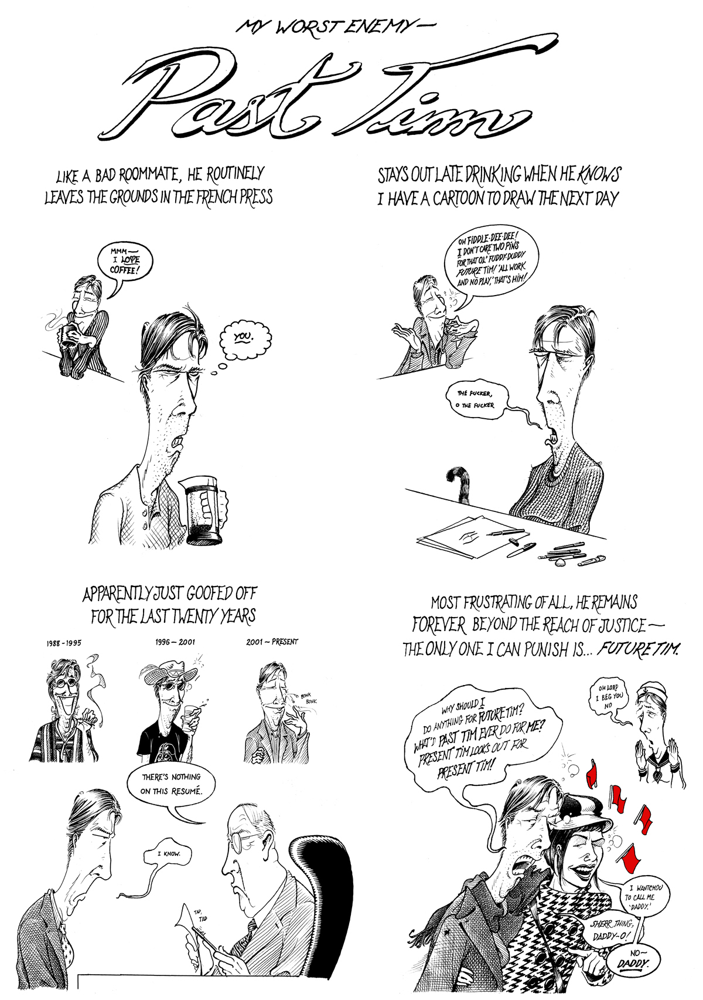

---
authors:
- first: KC
  last: Davis
  role: author
cover: ./cover.jpg
date_reviewed: '2026-11-17'
isbn: 978-1668002841
og_cover: ./og-cover.jpg
page_count: 160
publication_year: 2022
publisher: Simon Element
rating: 5.0
reads:
- date_finished: '2026-11-08'
  date_started: '2026-11-07'
  year: 2026
tags:
- self-help
title: 'How to Keep House While Drowning: A Gentle Approach to Cleaning and Organizing'
type: book
---
I've read a few books on compassionate living, and KC Davis' is the best. Based on her personal experiences as a new mother during the pandemic living in a small apartment with little support (hey...), and her professional work as a counselor, *How to Keep House While Drowning* is tightly written and precisely targeted to people clinging to sanity with their fingernails, offering both pragmatic tips and emotional reframing in a friendly and to-the-point manner.

The big point is that you don't exist to serve your space, your space exists to serve you. The care tasks that maintain a space have no inherent moral worth.

I'll start with the pragmatic tips.

There are exactly five types of things in any room.

1. Trash
2. Dishes
3. Laundry
4. Things out of place
5. Things that do not have a place

Seen that way, tidying becomes much easier. The most critical items, the ones which attract vermin, are at the top, and if you can just do those, that's enough. The harder decisions, like putting everything back or deciding what to do with ambiguous items, can be left until you're better resourced.

Use your habits instead of fighting them. If things pile up in a place, put a basket there. Davis has laundry baskets in every room, because her small children shed clothes constantly. For tasks which you've been procrastinating on, play a song and then get started. Track these hard ones with a timer to see that emptying the dishwasher takes three minutes, and isn't as scary as it looked. Or do the converse and clean for just three minutes. Anything to build momentum.

Tidiness isn't an abstraction: it's the closing chores that you do to set tomorrow's team up for a good day. Future you will appreciate it.

*Tim Kreider is a fantastic cartoonist and essayist, and an expert on the many crimes of Past Tim*

From an emotional perspective, flagellating yourself about cleanliness and lists undone hasn't worked, isn't working, and won't work. It just makes you feel bad. Not keeping up with the mess doesn't make you a bad person. Value commitments matter, but there are some things only *you* can do. There's really only one person who can make you take a shower or feed your cat. Once you're not miserable, you can look into saving the whales.

One particularly insightful reframing is that in committed relationships, what matters is not an equal contribution, but equal opportunities for leisure time. Even the most pleasant job would become unendurable 16 hours a day, with 365 days on call. Davis and her husband alternate who sleeps in on Saturdays and Sundays. "Who is doing more?" is a question that'll *never* be settled to mutual satisfaction. "Do we both have enough time for ourselves to stay sane?" does have an answer.

The book's organization and clarity are top-notch, and the advice scales from the worst hoarder disaster zone to a livable, even elegant home. There are no points for doing things the "proper" way: eat off of paper plates, hire a cleaning service, ask for help. Davis asks for a serious commitment to stop living in someone else's "shoulds," and start doing whatever you need to take care of yourself. I think that is the best advice of all. 
